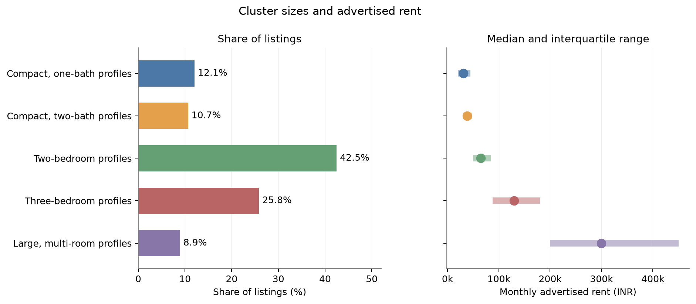

# Mumbai rental profiles — Group 3, Day 3

Ahmed Belahcen, Nandini Rathod, Sanjana Kiran and Akanksha Dhumal. AI Methods I, IAAC MaAI 2026/27.

- **Trained model and model card:** https://huggingface.co/iaac-maai/day3-group3-mumbai-rental-profiles
- **Enriched dataset:** https://huggingface.co/datasets/iaac-maai/group3-day3-mumbai-rental-profiles
- **Notebook:** [notebook/unsupervised_learning.ipynb](notebook/unsupervised_learning.ipynb)

## Use case

Architects, housing researchers and urban-design students can use these descriptive profiles to compare the physical composition of advertised Mumbai housing and explore how held-aside rent and furnishing vary across groups. One observation is a listing, not a verified unique dwelling. Clusters are not tenant categories or eligibility criteria.

## Question and method

Can Mumbai rental advertisements be grouped into useful physical profiles? This is descriptive unsupervised analysis, not rent prediction. The fitted pipeline median-imputes missing values, applies log1p to reported area, standardizes area, bedroom count and bathroom count, then fits K-Means with five clusters, n_init=20 and seed 42. Rent and furnishing are reserved for interpretation.

All 18,846 cleaned Day 2 listings are retained. Source: Harshal Honde’s [Property Rental Listings Dataset](https://www.kaggle.com/datasets/harshalhonde/property-rental-listings-dataset), attributed under the source documentation’s declared CC BY 4.0 licence. The cleaned CSV has SHA-256 `354d28e07432137cdc97a2197a556269137e74135af01186420e2e2917a19ee9`.

## Results

| ID | Name | Listings | Median area (reported ft²) | Median BHK / baths | Median rent (INR/month) |
|---|---|---:|---:|---:|---:|
| 0 | Two-bedroom profiles | 8,006 | 1,025 | 2 / 2 | 65,000 |
| 1 | Three-bedroom profiles | 4,870 | 1,575 | 3 / 3 | 130,000 |
| 2 | Compact, one-bath profiles | 2,272 | 565 | 1 / 1 | 31,000 |
| 3 | Large, multi-room profiles | 1,685 | 2,750 | 4 / 4 | 300,000 |
| 4 | Compact, two-bath profiles | 2,013 | 650 | 1 / 2 | 38,000 |

Names reflect typical physical medians, not universal rules. Rent was not used to form the clusters.



Clusters describe typical physical profiles, not strict housing categories. Rent points show medians; segments show the interquartile range.

The fixed 3,000-row sample silhouette is 0.5793 at k=5 and 0.5719 at k=4. The five-group solution is an interpretable working choice. K-Means and Ward are also compared on the same reference sample. Mean assignment ARI is 0.9922 across five seeds and 0.9910 across five 80% subsample refits. Equal weighting of distinct physical profiles lowers agreement to 0.8415, showing sensitivity to repeated profiles.


PCA retains 96.31% of variance in two dimensions. PCA and t-SNE are visualisations; clustering uses all three prepared physical features. t-SNE island distances and sizes do not establish real-world separation.

## Run the notebook

Use Python 3.12. From the repository root:

```bash
python -m venv .venv
# Windows: .venv\Scripts\activate
# macOS/Linux: source .venv/bin/activate
python -m pip install -r requirements.txt
python -m pip install jupyterlab nbclient==0.10.2 nbformat==5.10.4 ipykernel==6.29.5
jupyter lab
```

Open `notebook/unsupervised_learning.ipynb`, select this environment, restart the kernel and run all cells. The notebook works from its own folder or the repository root. The CSV is in `data/mumbai_cleaned.csv`. t-SNE can take several minutes. The full trained pipeline and usage example are available from the model link above.

The model accepts `Area_num`, `BHK_num` and `Bathrooms_num` in a pandas DataFrame and returns an unordered cluster ID. It does not predict rent. See the model card for a download-and-predict example and the dataset card for the schema.

## Limitations

Advertisements are not verified transactions or unique dwellings. Repeated listings affect clustering. Area units and listing dates are uncertain; Location gives only Mumbai, without neighbourhood detail. Cluster names describe medians, not universal rules. Use for educational exploration, not tenant selection, credit, current valuations or causal claims.

## Repository structure

| Path | Purpose |
|---|---|
| `notebook/unsupervised_learning.ipynb` | Complete analysis and reproducible exports |
| `data/mumbai_cleaned.csv` | Frozen cleaned input; source and checksum in `data/PROVENANCE.md` |
| `figures/` | Notebook-exported PNG and SVG figures |
| `models/` | Model card, evaluation and inference example; generated joblib files ignored |
| `dataset/` | Dataset card and figures; generated CSV exports ignored |
| `requirements.txt` | Pinned analysis dependencies |
| `.github/workflows/validate-day3.yml` | Fresh-environment notebook and published-model checks |

Published model binaries and enriched CSV files belong on Hugging Face. Running the notebook regenerates their local canonical filenames; it does not upload or replace the published artifacts. Run `python models/verify_published.py` to download the pinned Hub model into a fresh temporary folder, check its checksum, predict a hand-made example and compare every regenerated cluster assignment.

## Files and licences

`notebook/unsupervised_learning.ipynb` contains the analysis; `figures/` contains exported plots; `models/` contains model documentation and evaluation; `dataset/` contains its card and local ignored enriched-table exports; `data/` contains the cleaned source snapshot. The trained pipeline is also published on Hugging Face.

Code and model: MIT, see [LICENSE](LICENSE). Data retains its separately declared CC BY 4.0 attribution.

## AI usage disclosure

- **Tools:** ChatGPT/Codex, as recorded in the existing project documentation and this cleanup.
- **Why:** Assist with code, figures, explanations and reproducible repository organization.
- **Where:** Notebook export cells, README, dataset/model documentation and validation workflow.
- **How:** Suggestions were checked against the source checksum, executed outputs, cluster assignments, PCA coordinates and model reloading. Numerical results come from computation, not AI-generated estimates.
- **Lessons learned:** A published dataset and model need separate cards and clear links. Embeddings should not be overinterpreted, cluster IDs are unordered, and a clean sequential execution is necessary to validate a notebook. This disclosure is not a complete log of every team member's earlier tool usage.
