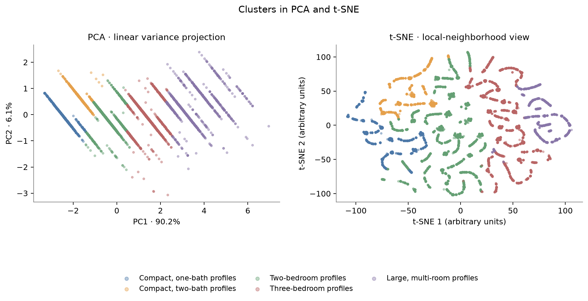

# Mumbai rental profiles — Group 3, Day 3

Ahmed Belahcen, Nandini Rathod, Sanjana Kiran and Akanksha Dhumal. AI Methods I, IAAC MaAI 2026/27.

- **Trained model and model card:** https://huggingface.co/iaac-maai/day3-group3-mumbai-rental-profiles
- **Enriched dataset:** https://huggingface.co/datasets/iaac-maai/group3-day3-mumbai-rental-profiles
- **Notebook:** [Unsupervisedlearning.ipynb](Unsupervisedlearning.ipynb)

## Question and method

Can Mumbai rental advertisements be grouped into useful physical profiles? This is descriptive unsupervised analysis, not rent prediction. The fitted pipeline median-imputes missing values, applies log1p to reported area, standardizes area, bedroom count and bathroom count, then fits K-Means with five clusters, n_init=20 and seed 42. Rent and furnishing are reserved for interpretation.

All 18,846 cleaned Day 2 listings are retained. Source: Harshal Honde’s [Property Rental Listings Dataset](https://www.kaggle.com/datasets/harshalhonde/property-rental-listings-dataset), attributed under the source documentation’s declared CC BY 4.0 licence. The cleaned CSV has SHA-256 `354d28e07432137cdc97a2197a556269137e74135af01186420e2e2917a19ee9`.

## Results

Clusters describe typical physical profiles, not strict housing categories. Rent points show medians; segments show the interquartile range.

The fixed 3,000-row sample silhouette is 0.5793 at k=5 and 0.5719 at k=4. The five-group solution is an interpretable working choice. K-Means and Ward are also compared on the same reference sample. Mean assignment ARI is 0.9922 across five seeds and 0.9910 across five 80% subsample refits. Equal weighting of distinct physical profiles lowers agreement to 0.8415, showing sensitivity to repeated profiles.

PCA retains 96.31% of variance in two dimensions. PCA and t-SNE are visualisations; clustering uses all three prepared physical features. t-SNE island distances and sizes do not establish real-world separation.

## Run the notebook

Use Python 3.12. Install `requirements.txt`, open `Unsupervisedlearning.ipynb`, select the Python environment and run all cells from the project root. The CSV is in `data/mumbai_cleaned.csv`. t-SNE can take several minutes. The full trained pipeline and usage example are available from the model link above.

The model accepts `Area_num`, `BHK_num` and `Bathrooms_num` in a pandas DataFrame and returns an unordered cluster ID. It does not predict rent. See the model card for a download-and-predict example and the dataset card for the schema.

## Limitations

Advertisements are not verified transactions or unique dwellings. Repeated listings affect clustering. Area units and listing dates are uncertain; Location gives only Mumbai, without neighbourhood detail. Cluster names describe medians, not universal rules. Use for educational exploration, not tenant selection, credit, current valuations or causal claims.

## Files and licences

`Unsupervisedlearning.ipynb` contains the analysis; `figures/` contains exported plots; `models/` contains model documentation and evaluation; `dataset/` contains the enriched table and its card; `data/` contains the cleaned source snapshot. The trained pipeline is also published on Hugging Face.

Code and model: MIT, see [LICENSE](LICENSE). Data retains its separately declared CC BY 4.0 attribution.

## AI usage

ChatGPT/Codex assisted with code, figures and documentation. Checks included the CSV checksum, full notebook execution, cluster assignments, PCA coordinates and model reloading.
