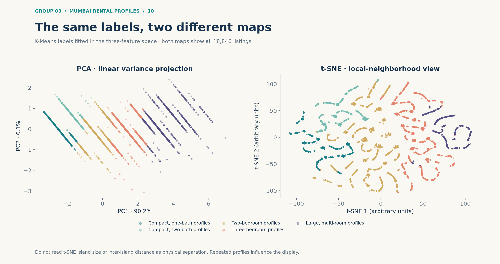

# Mumbai rental physical profiles - enriched dataset

Local dataset card, awaiting group review; no remote dataset has been published. Authors: Ahmed Belahcen, Nandini Rathod, Sanjana Kiran and Akanksha Dhumal, Group 3, AI Methods I, IAAC MaAI 2026/27.

## Source, license and changes

Source: [cleaned Day 2 snapshot](https://github.com/iaac-maai/group-3-day2-assignment/blob/6b2a6d17af8c4d8950f12e60dc97f8b9a8d4dbc1/data/mumbai_cleaned.csv), derived from Harshal Honde's [Property Rental Listings Dataset](https://www.kaggle.com/datasets/harshalhonde/property-rental-listings-dataset). The dataset is attributed under the source's declared CC BY 4.0 license; the existing project code/model license is MIT (see ../LICENSE). MIT does not replace the source data's attribution/license. Original collection date and listing verification are unavailable.

This derivative retains all 18,846 rows, adds preprocessing fields, five named cluster assignments and PCA/t-SNE coordinates, and selects 22 columns. Original missing values remain visible; imputation is in separate engineered fields. Titles, descriptions and image links are omitted. No rows are claimed to be unique dwellings and no personal-identity audit of the original source is implied. There is one full exploratory table, not supervised train/test splits. Collection date is unknown.

## Schema

| Column | CSV read dtype | Meaning |
|---|---|---|
| source_row | int64 | Zero-based row position in the unchanged source snapshot; not a dwelling ID. |
| Area_num | float64 | Original reported area, source says square feet; row unit consistency unverified. |
| BHK_num | float64 | Original bedroom count. |
| Bathrooms_num | float64 | Original bathroom count, including missing values. |
| Balconies_num | float64 | Original balcony count, including missing values; not a model input. |
| Price_num | float64 | Advertised monthly rent in INR; interpretation only. |
| Furnished_clean | str | Original cleaned furnishing category, including missing values; interpretation only. |
| Facing | str | Original cleaned orientation label; Unknown retained. |
| Location | str | City label, Mumbai; not neighborhood information. |
| Property Type | str | Original property-type category; interpretation only. |
| log_area | float64 | ln(1 + Area_num), before scaling. |
| bathrooms_imputed | float64 | Bathroom count after fitted median imputation (2). |
| bathroom_was_missing | bool | Boolean indicator of missing original bathroom count. |
| log_area_scaled | float64 | Standardized log-area using full-data fitted mean/scale. |
| bhk_scaled | float64 | Standardized bedroom count using fitted mean/scale. |
| bathrooms_scaled | float64 | Standardized imputed bathroom count using fitted mean/scale. |
| cluster | int64 | Integer K-Means assignment 0-4; unordered. |
| cluster_name | str | Descriptive typical physical profile mapped from cluster ID. |
| pca_x | float64 | First PCA score, arbitrary standardized-feature projection units. |
| pca_y | float64 | Second PCA score. |
| tsne_x | float64 | First t-SNE coordinate; arbitrary units. |
| tsne_y | float64 | Second t-SNE coordinate; arbitrary units. |

## How labels and maps were made

The full pipeline median-imputes numeric inputs, applies ln(1 + area), standardizes the three features and fits K-Means (k=5, n_init=20, random_state=42). Only Area_num, BHK_num and Bathrooms_num form clusters. Rent, furnishing, facing and property type describe results afterwards. Balconies are excluded because more than half are missing. All 18,846 listings are retained; 15 missing bathroom values are imputed to 2 inside the fitted pipeline.

PCA is fitted on the prepared three-feature space for visualization; its first two axes retain 96.3069915% of variance. t-SNE uses all rows, perplexity=40, init=pca, learning_rate=auto, max_iter=1000, random_state=42, Barnes-Hut, angle=0.5 and two output dimensions. Neither embedding forms the K-Means inputs. The fitted clustering pipeline can predict new inputs; the exported t-SNE map cannot transform new listings.

| ID | Typical profile | Listings | Median area | Median bedrooms / baths | Median rent INR/month |
|---|---|---:|---:|---:|---:|
| 0 | Two-bedroom profiles | 8,006 | 1,025 | 2 / 2 | 65,000 |
| 1 | Three-bedroom profiles | 4,870 | 1,575 | 3 / 3 | 130,000 |
| 2 | Compact, one-bath profiles | 2,272 | 565 | 1 / 1 | 31,000 |
| 3 | Large, multi-room profiles | 1,685 | 2,750 | 4 / 4 | 300,000 |
| 4 | Compact, two-bath profiles | 2,013 | 650 | 1 / 2 | 38,000 |

## Quality and limitations

K-Means k=2,...,8 is fitted on the full dataset. Silhouette is evaluated on the same fixed 3,000-row random sample (seed 42): k=5 scores 0.5792832075113192 versus k=4 at 0.5718932442523518. Full-data inertia at k=5 is 6962.908980584956. The elbow is around four to five; five is a working interpretation, not a verified ground truth.

A separate fair comparison refits preprocessing and both K-Means and Ward hierarchical clustering on that same 3,000-row reference subset. At k=5 their silhouettes are 0.5817217246340777 and 0.573165655223993; agreement ARI is 0.8839211748987167. The notebook includes the Ward dendrogram.

Five seeds (7, 21, 42, 84, 123) give mean full-data assignment ARI 0.9922043456759448 (population SD 0.004798840195798869). Five 80% subsample refits, including preprocessing refitted on each subset, give mean ARI on all listings 0.9910121873666575 (SD 0.0047200014888221535). Scores for excluded rows are also recorded. Equal weighting of 2,478 distinct raw physical tuples gives ARI 0.8414894188661575 against the reference assignments, demonstrating sensitivity to repeated profiles. ARI is agreement, not predictive accuracy. These are exploratory internal checks, not a supervised train/test evaluation. Exact records are in models/evaluation.json.

Listings are not verified unique dwellings. Repeated characteristics influence weighting, and cluster names describe medians rather than strict membership rules. The source reports area in square feet, but row-level unit consistency is unverified. Rent is advertised monthly INR, not a transaction price. Collection date is unknown. Location is only Mumbai, not a neighborhood. Bedrooms and bathrooms have equal standardized-feature weighting to log-area, which is a modeling choice. No demographic or causal conclusions are supported. Use for classroom descriptive exploration; do not use for tenant selection, credit, automated valuation or claims about today's market.

## Load and explore

```python
import pandas as pd
import matplotlib.pyplot as plt
df = pd.read_csv("dataset/mumbai_rental_profiles.csv")
for name, group in df.groupby("cluster_name"):
    plt.scatter(group.pca_x, group.pca_y, s=3, alpha=.3, label=name)
plt.xlabel("PC1"); plt.ylabel("PC2")
plt.legend(); plt.show()
```

The related local model and its working inference example are in ../models/. The complete notebook, numerical evaluation and reproducibility instructions are in the parent project. Remote download examples can be added after the group approves publication and actual repository URLs exist.



Enriched CSV SHA256: `329f9a93a47d42fec277642cc229d2ba2810498b52699763e529ffb287c88a74`.
Source SHA256: `354d28e07432137cdc97a2197a556269137e74135af01186420e2e2917a19ee9`.
